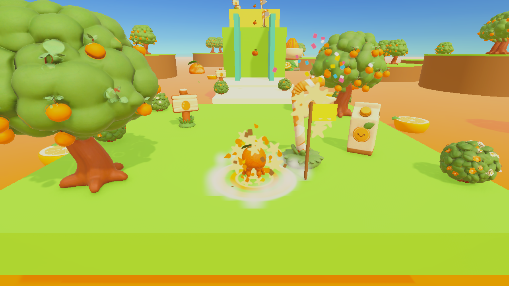
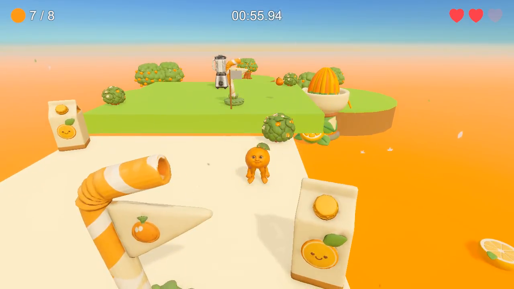
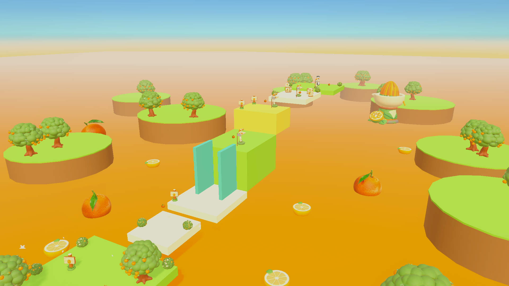
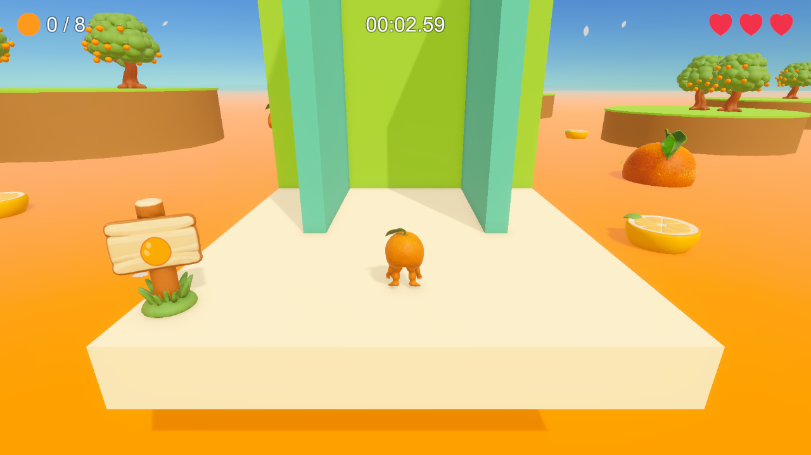
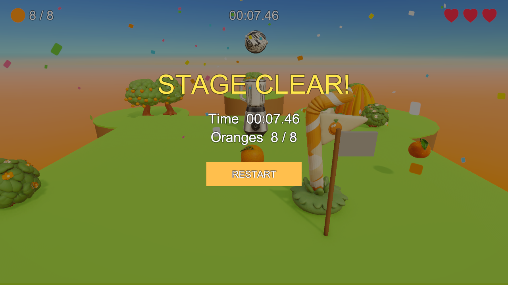

# 🍊 Orange Platformer

귤 캐릭터가 과수원 섬을 건너며 귤 8개를 모으고, 뚜껑이 열린 믹서기 안으로 뛰어들면 클리어하는 **3D 액션 플랫포머 1스테이지 프로토타입**입니다.
마리오 64 · 어 햇 인 타임처럼 여러 이동 액션을 익혀 스테이지를 건너는 재미를 목표로 했습니다.

> 2026 대전 KNDA 게임 개발 과정 · 제2차 성취도 평가 (Unity 게임 프로토타입 개발) · 우정완



## 플레이 영상 (1분 18초)

[](https://github.com/wakhang/orange-platformer/blob/main/Docs/Video/OrangePlatformer_Gameplay.mp4)

▶ 이미지를 누르면 영상이 열립니다 · [Docs/Video/OrangePlatformer_Gameplay.mp4](Docs/Video/OrangePlatformer_Gameplay.mp4)

## 다운로드 · 문서

| 항목 | 링크 |
|---|---|
| 실행 빌드 (Windows 64bit) | [Releases v1.0 · OrangePlatformer_Windows.zip](https://github.com/wakhang/orange-platformer/releases/tag/v1.0) — 압축 해제 후 `OrangePlatformer.exe` 실행 |
| 플레이 영상 (1분 18초) | [Docs/Video/OrangePlatformer_Gameplay.mp4](Docs/Video/OrangePlatformer_Gameplay.mp4) · [Releases에서 다운로드](https://github.com/wakhang/orange-platformer/releases/tag/v1.0) |
| 포트폴리오 PDF | [Docs/Portfolio/02_Unity_우정완.pdf](Docs/Portfolio/02_Unity_우정완.pdf) |
| 기획서 | [Docs/Design/OrangePlatformer.md](Docs/Design/OrangePlatformer.md) · [OrangePlatformerPolish.md](Docs/Design/OrangePlatformerPolish.md) |
| 1차 평가 리소스 | [wakhang/orange-platformer-assets](https://github.com/wakhang/orange-platformer-assets) (귤 캐릭터 · 귤 · 믹서기 FBX) |

## 조작

| 동작 | 키보드 · 마우스 | 설명 |
|---|---|---|
| 이동 / 시점 | WASD / 마우스 | 카메라 기준 이동, 3인칭 궤도 카메라 (게임패드 지원) |
| 점프 · 이단 점프 | Space (공중에서 한 번 더) | 길게 누르면 더 높게, 코요테 타임 · 점프 버퍼 적용 |
| 웅크리기 · 높이뛰기 | Shift / C → Space | 웅크린 채 점프하면 4 m 높이뛰기 |
| 다이브 | 공중에서 E / 좌클릭 | 앞으로 몸통 박치기 후 배로 미끄러짐 |
| 벽 점프 | 청록 벽에 붙어 Space | 벽 슬라이드 후 반대쪽으로 튕겨 오름 |
| 엉덩방아 | 공중에서 Shift / C | 내려찍어 과일 상자를 부숨 |
| 일시정지 / 확인 | Esc / Enter | |

## 게임 규칙

- 귤 **8개**(그중 2개는 상자 속)를 모으면 믹서기 뚜껑이 열리고, 용기 안으로 들어가면 **승리**합니다.
- 주스 바다에 빠지면 하트가 1개 줄고 마지막 체크포인트에서 부활합니다. 하트 3개를 모두 잃으면 **게임오버**입니다.
- 각 구간은 해당 액션 없이는 지나갈 수 없도록 수치로 설계했습니다.

| 구간 | 장애 | 필요한 액션 |
|---|---|---|
| 벽 점프 수직갱 | 높이 6 m | 벽 점프 |
| 높은 단 | 높이 3.5 m | 높이뛰기 (4.0 m) |
| 넓은 틈 | 폭 8 m | 점프 + 다이브 |
| 과일 상자 | 상자 속 귤 | 엉덩방아 |

| 스테이지 전체 | 벽 점프 구간 | 클리어 |
|---|---|---|
|  |  |  |

## 기술 구성

- **엔진:** Unity 6 (6000.6.0f1) · URP 17.6 · Input System 1.20 · uGUI
- **캐릭터:** CharacterController 기반 9상태 상태 기계 (FixedUpdate 50 Hz), 렌더 보간으로 걷기 떨림 제거
- **규칙:** Unity에 의존하지 않는 순수 C# 모델 `GameRulesModel` + 이벤트 기반 UI 연동
- **연출:** 애니메이션 9종(VARCO 3D Animate → Blender로 1차 리그에 이전), 이벤트 기반 파티클 이펙트 20종(오브젝트 생성 없이 Emit)
- **테스트:** EditMode 테스트 28개 (규칙 모델 · 이동 수학 · 애니메이션 상태 · 보간)

```
Assets/
  Scripts/OrangePlatformer/        Core(계약) · Gameplay(Player/Camera/Input/Level/Session/Vfx) · UI · Tests
  Scripts/OrangePlatformerPolish/  렌더 보간 · 애니메이션 드라이버 · Tests
  Art/                             1차 FBX 3종 · VARCO 장식 8종 · 이펙트 텍스처
  Prefabs/  Scenes/OrangePlatformer.unity  Settings/
ArtSource/   VARCO·Blender 출력 FBX와 텍스처
Docs/        기획서 · 포트폴리오 PDF · 이미지
```

## AI 활용 개발

**OMP Studio 워크플로**로 개발했습니다. 기획 · 코드 · UI · 3D 에셋 · 씬 구성 · 검증을 맡는 AI 에이전트들을 노드로 연결하고, 저는 요청문 작성 · 계획 승인 · 플레이 피드백을 맡았습니다.

```
요청 → 계획(Claude Opus) → 계획 승인 → [게임플레이 ∥ UI ∥ 3D 에셋] → 씬 구성(Unity MCP)
     → 컴파일+EditMode 테스트 → 플레이 테스트(GPT-6.1 Sol) → 직접 플레이 확인 → 완료
                         ↑ 실패 시 수정 에이전트(Sonnet) — 최대 4회
```

- Unity · Blender · VARCO 3D를 MCP로 연결해 AI가 에디터를 직접 조작했습니다.
- 요청문, 수정 내용, AI 코드 오류 10건의 원인 · 해결 과정은 [포트폴리오 PDF](Docs/Portfolio/02_Unity_우정완.pdf) 7~9장에 정리했습니다.

## 실행 방법 (소스)

1. Unity Hub에서 **Unity 6000.6.0f1**로 이 폴더를 엽니다.
2. `Assets/Scenes/OrangePlatformer.unity`를 열고 Play 합니다.
